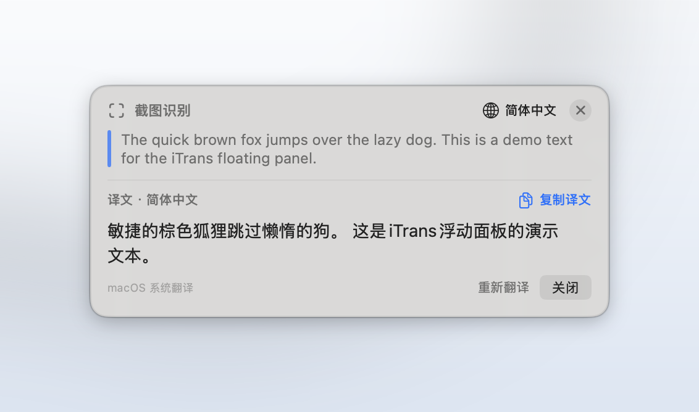
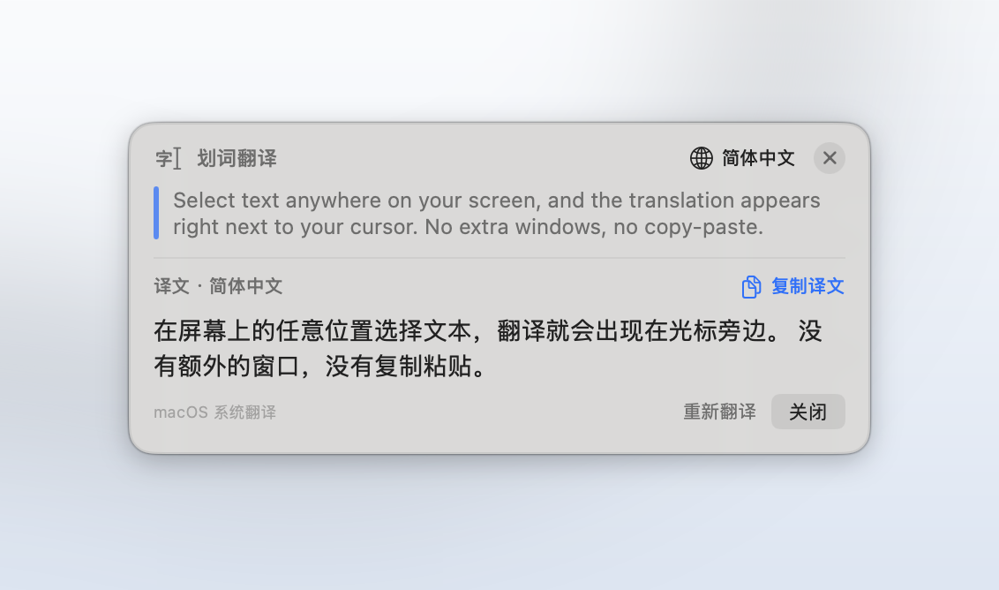
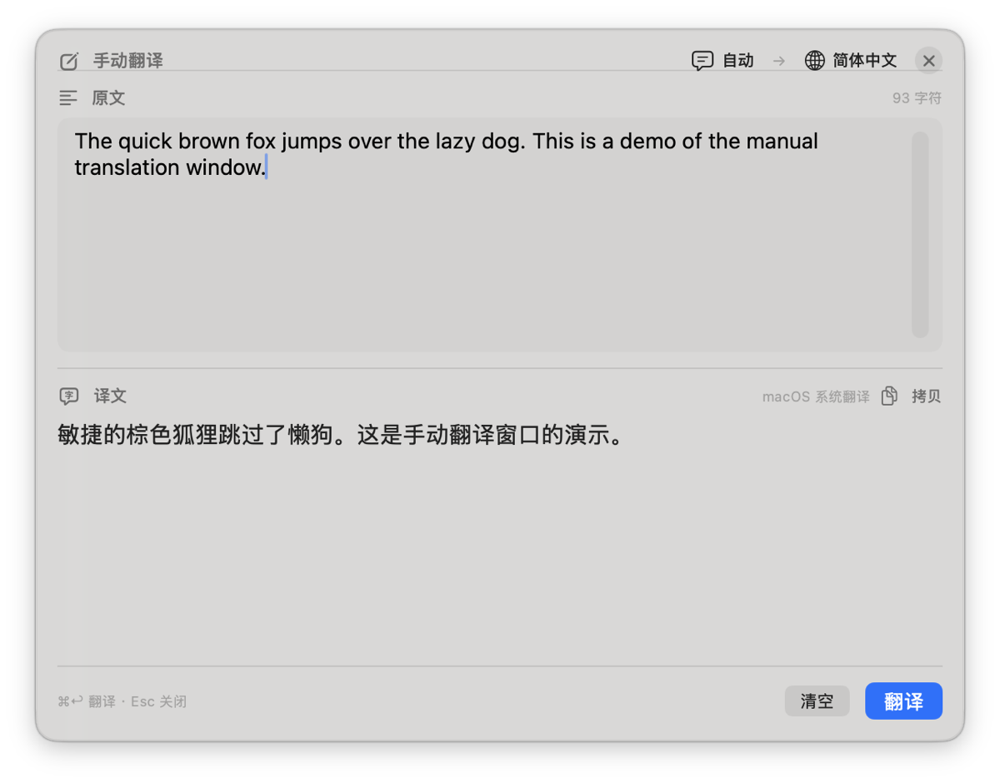
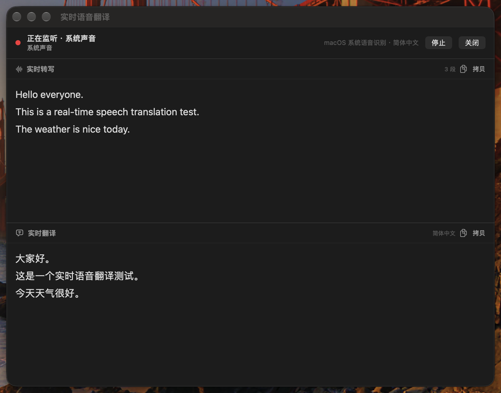
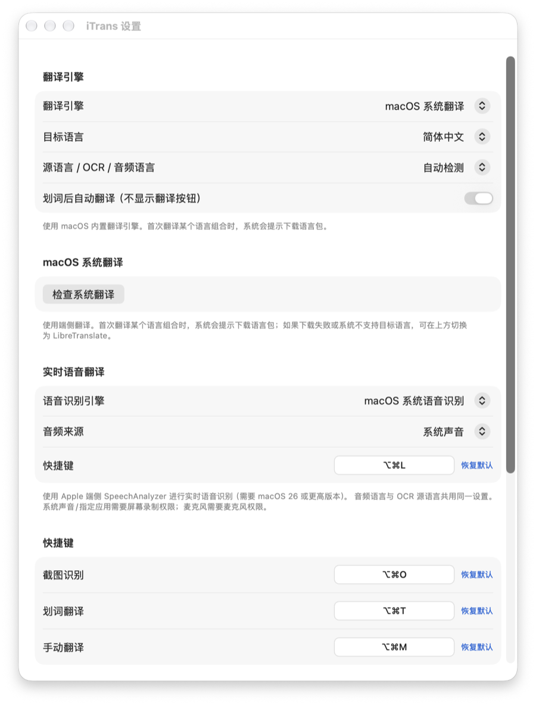

# iTrans

[English](README_en.md) | 简体中文

原生 macOS 菜单栏翻译工具，支持**截图 OCR 翻译**、**划词翻译**、**手动文本翻译**和**实时语音翻译**。

应用常驻菜单栏（无 Dock 图标），正常使用时没有窗口；通过全局快捷键触发，结果显示在鼠标附近或独立的实时语音翻译窗口中。翻译引擎可在 **macOS 系统翻译**与 **LibreTranslate** 之间切换。

当前版本：**1.2.0**，版本历史见 [CHANGELOG.md](CHANGELOG.md)。

## 功能特性

- **截图识别 OCR**：快捷键框选屏幕区域 → 本地 Vision OCR → 自动翻译 → 鼠标附近显示译文
- **划词翻译**：读取当前选中文本（Accessibility API，失败时回退模拟 ⌘C）→ 翻译 → 显示译文
- **手动翻译**：快捷键打开文本翻译窗口，输入或粘贴文字，自动检测或手动指定源语言，随时切换目标语言
- **实时语音翻译**：监听系统声音、指定应用或麦克风，实时转写并翻译到独立的上下分栏窗口
- **双翻译引擎**：默认使用 macOS 系统翻译，也可切换到 LibreTranslate
- **一键拷贝**：OCR/划词结果面板、实时语音翻译的原文与译文窗格均可复制
- **可移动 / 可调整大小的窗口**：划词/OCR 结果面板支持拖动定位；手动翻译与实时语音翻译窗口支持拖动、拖拽边缘或角落调整大小，下次打开会记住窗口尺寸
- **接口自动发现**：读取 OpenAPI 3 / Swagger 2.0 规范，自动匹配翻译接口与字段
- **多显示器 / Retina**：在任意屏幕框选，按实际像素裁剪
- **菜单栏常驻**：通过 `LSUIElement` 隐藏 Dock 图标，菜单中显示当前引擎与权限状态

## 截图

以下 OCR / 划词 / 实时语音截图中的语言内容为演示数据，实际翻译结果取决于所选区域、音频和翻译引擎。

### 截图 OCR 翻译

[](docs/screenshots/ocr-translation.png)

### 划词翻译

[](docs/screenshots/selection-translation.png)

### 手动翻译

[](docs/screenshots/manual-translation.png)

### 实时语音翻译

[](docs/screenshots/live-speech-translation.png)

### 设置与翻译引擎

[](docs/screenshots/settings.png)

## 截图 OCR

1. 按 `⌥⌘O`。
2. 拖拽框选需要识别的屏幕区域，`Esc` 取消。
3. 应用在本地使用 Vision 识别文字，随后自动调用所选翻译引擎。
4. 译文显示在鼠标附近的浮动面板中；失败时可在面板中重试或打开接口设置。

OCR 始终自动翻译，无需再点击翻译按钮。结果面板标题栏可切换目标语言，切换后会重新翻译当前结果。OCR 识别语言与音频语言共用设置中的“源语言 / OCR / 音频语言”。

## 划词翻译

1. 在任意应用中选中文本。
2. 按 `⌥⌘T`。
3. 应用通过 Accessibility 读取选中文字；不支持时会模拟 ⌘C（并恢复原剪贴板）。
4. 默认在鼠标附近显示“翻译”按钮；开启“划词后自动翻译”后会直接显示译文。

结果面板标题栏可切换目标语言，面板支持拖动移动，右上角可关闭。结果面板支持复制原文/译文、重新翻译，按 `Esc` 或点击面板外部关闭。

## 手动翻译

默认快捷键 `⌥⌘M`。按下后打开文本翻译窗口，可直接输入或粘贴需要翻译的文字，按 `⌘↩` 或点击「翻译」开始翻译。

- **源语言**：标题栏菜单默认「自动检测」，也可手动指定语言。与 OCR/音频语言共用同一设置。
- **目标语言**：标题栏菜单切换，与 OCR/划词结果面板、实时语音窗口和设置界面实时同步。
- 切换源语言或目标语言后，若已有翻译结果，会自动重新翻译。
- 译文支持一键拷贝，窗口内可清空重来；按 `Esc` 或点击右上角关闭按钮关闭窗口。
- 窗口与实时语音窗口使用相同的圆角浮动面板样式，可拖动、调整大小，并记住尺寸和位置。

## 实时语音翻译

默认快捷键 `⌥⌘L`。再次按下快捷键或点击窗口右上角关闭按钮即可停止并关闭；窗口内「停止」会停止监听但保留当前内容。关闭后再次按快捷键会开启新的会话。

窗口采用与划词/OCR 结果面板相同的圆角浮动面板样式，可拖动移动，并分为上下两部分。拖动窗口边缘或四个角落即可调整大小，最小尺寸为 520 × 360，右下角有细微的拖拽提示；窗口尺寸和位置会被记住，下次打开时自动恢复。

- **上方**：实时显示语音转写，未定稿文字以次要颜色显示。
- **下方**：实时显示对应译文，定稿分段逐段追加，未定稿部分显示实时预览。
- 两个窗格标题栏右侧都有「拷贝」按钮：
  - 一键复制全部转写原文。
  - 一键复制全部译文。
  - 复制内容包含当前已显示的文字，按钮短暂显示“已拷贝”。
- **音频语言**：窗口标题栏提供音频语言菜单，与设置中的“源语言 / OCR / 音频语言”共用同一设置。修改后会重启语音识别并保留当前转写，同时同步更新设置界面。
- **目标语言**：在划词/OCR 结果面板标题栏、实时语音翻译窗口标题栏或设置中选择；三个位置共享同一设置，切换后新产生的译文会使用新目标语言，划词/OCR 当前结果会自动重新翻译。
- 所有语言选择都保存在共享设置中，设置界面会实时同步。

音频来源（默认：系统声音）：

- **系统声音**：捕获整个系统的音频，不包含 iTrans 自身。
- **指定应用**：只捕获所选应用（会议软件、浏览器等）的音频。
- **麦克风**：使用系统默认输入设备，适合面对面会议、语音输入等场景。

语音识别使用 macOS 26+ 的端侧 `SpeechAnalyzer` / `SpeechTranscriber`，不依赖 Siri 或听写功能。音频语言可在窗口菜单中选择或跟随系统，也可指定中文、English、日本語、한국어 等；它与 OCR 源语言共用同一设置。目前内置一个语音识别引擎，后续可扩展第三方引擎。

## 翻译引擎

可在设置中随时切换，切换后对 OCR、划词和实时语音翻译生效。

### macOS 系统翻译（默认）

- 使用 Apple 端侧 `Translation` 框架，文本不离开本机。
- 源语言为“自动检测”时使用系统语言识别；也可固定源语言。
- 首次翻译某个语言组合时，macOS 会提示下载语言包；下载完成后自动继续。
- 设置中提供「检查系统翻译」按钮，可查看语言包状态。
- 系统语言包缺失或目标语言不受支持时，可切换为 LibreTranslate。

### LibreTranslate

- 默认服务地址：`http://192.168.3.3:5000`。
- 自动读取 `/openapi.json`、`/spec` 等规范，发现翻译路径、字段名和响应字段。
- 支持 JSON 与 `application/x-www-form-urlencoded` 请求。
- 当前验证的服务为 LibreTranslate 1.9.6（Flask + Flasgger）。
- 如需自行部署，可使用仓库中的 `docker-compose.yaml`，详见下方“高级：使用 Docker 部署 LibreTranslate”。

## 默认快捷键

| 操作 | 快捷键 |
| --- | --- |
| 截图识别 OCR | `⌥⌘O` |
| 划词翻译 | `⌥⌘T` |
| 手动翻译 | `⌥⌘M` |
| 实时语音翻译 | `⌥⌘L` |

点击设置中的快捷键框可重新录制，需要至少一个修饰键。设置保存在 `UserDefaults`（`com.linimbus.itrans`）。

## 环境要求与构建

- macOS 26.0 或更高版本
- Xcode 26+（Swift 6 工具链）

```bash
# 构建并启动
./scripts/run.sh

# 只构建
./scripts/build_app.sh
open build/iTrans.app

# 生成发布文件（DMG / ZIP / SHA256）
./scripts/release.sh
```

生成的应用位于 `build/iTrans.app`，使用 ad-hoc 签名。也可以直接用 Xcode 打开 `Package.swift` 调试。

`release.sh` 会把发布产物写入 `dist/`：

- `iTrans-<版本>.dmg`：包含应用和 `Applications` 快捷方式，打开后拖入即可安装。
- `iTrans-<版本>.zip`：应用压缩包，便于分发或归档。
- `SHA256SUMS.txt`：两个产物的 SHA-256 校验值。

由于使用 ad-hoc 签名，首次打开时可能被 Gatekeeper 拦截，可在「系统设置 → 隐私与安全性」中允许，或执行 `xattr -dr com.apple.quarantine /Applications/iTrans.app`。

建议把 `iTrans.app` 拷贝到 `/Applications` 后日常使用，以保持系统权限记录稳定。每次重新构建后，如果权限失效，需要在系统设置中重新勾选。

## 首次使用与权限

1. 启动后菜单栏出现「文」字气泡图标，正常使用时没有窗口。
2. 点击菜单栏图标 → **设置…**，选择翻译引擎和目标语言。
   - 系统翻译首次使用时会提示下载语言包。
   - 使用 LibreTranslate 时确认服务地址。
3. 授予所需权限：
   - **屏幕录制**：截图 OCR、系统声音/指定应用音频捕获需要。首次使用时系统会提示；如果未出现在列表中，请在「系统设置 → 隐私与安全性 → 屏幕录制」中勾选 `iTrans`，然后重启应用。
   - **辅助功能**：划词翻译需要。在「系统设置 → 隐私与安全性 → 辅助功能」中勾选 `iTrans`。
   - **麦克风**：麦克风实时翻译需要。首次开启麦克风监听时系统会提示授权。
4. 按快捷键开始使用。

菜单栏菜单会展示辅助功能/屏幕录制授权状态；设置窗口也会实时显示权限状态和跳转按钮。

## 设置说明

### 翻译引擎

- 翻译引擎：macOS 系统翻译 / LibreTranslate
- 目标语言
- 源语言 / OCR / 音频语言
- 划词后自动翻译（不显示翻译按钮）

### 实时语音翻译

- 语音识别引擎（当前为 macOS 系统语音识别）
- 音频来源：系统声音 / 指定应用 / 麦克风
- 指定应用时：选择正在运行的应用，可刷新列表
- 麦克风时：显示当前默认输入设备
- 音频语言通过上方“源语言 / OCR / 音频语言”设置，并与实时语音窗口菜单同步
- 实时语音翻译快捷键

### 系统权限

显示辅助功能、屏幕录制、麦克风的授权状态，并提供授权或打开系统设置的入口。

### 高级设置（LibreTranslate）

- 接口路径（留空自动发现）
- 请求方法（POST / GET）
- 文本字段、目标语言字段、源语言字段
- 译文响应路径（如 `data.translation`）
- 目标语言发送值

如果需要在本机或内网自行部署 LibreTranslate，请参考下方的“高级：使用 Docker 部署 LibreTranslate”。

### 其他

- 快捷键录制（截图识别 / 划词翻译 / 手动翻译 / 实时语音翻译）
- 恢复默认设置
- 当前版本信息

## LibreTranslate 接口适配

选择 LibreTranslate 后，默认后端为 Flask + Flasgger（LibreTranslate）服务：

- 文档：`http://192.168.3.3:5000/docs/`
- 规范：`http://192.168.3.3:5000/spec`（Swagger 2.0）
- 翻译：`POST /translate`，`application/x-www-form-urlencoded`
  - `q`：待翻译文本
  - `source`：源语言，自动检测时传 `auto`
  - `target`：目标语言，如 `zh-Hans`、`zh-Hant`、`en`
- 响应：`{"translatedText": "...", "detectedLanguage": {...}}`

示例：

```bash
curl -X POST http://192.168.3.3:5000/translate \
  -d 'q=Hello world&source=auto&target=zh-Hans'
```

应用首次翻译时会自动读取规范并发现接口，无需手动配置。规范不可读时会使用内置的 LibreTranslate 兼容兜底配置。

## 高级：使用 Docker 部署 LibreTranslate

仓库根目录提供 `docker-compose.yaml`，可以在本机或内网服务器上运行 LibreTranslate，作为 iTrans 的翻译引擎。

### 快速开始

前置条件：macOS 上安装 Docker Desktop 或 OrbStack；或使用任意 Docker Engine + Compose v2。

```bash
# 在项目根目录执行
docker compose up -d

# 查看启动日志；首次启动会下载语言模型，可能需要几分钟
docker compose logs -f libretranslate
```

服务就绪后检查：

```bash
curl http://127.0.0.1:5000/health
curl http://127.0.0.1:5000/languages
```

测试翻译：

```bash
curl -X POST http://127.0.0.1:5000/translate \
  -d 'q=Hello world&source=auto&target=zh-Hans'
```

在 iTrans 设置中选择 LibreTranslate，并将服务地址改为：

- Docker 与本应用在同一台 Mac：`http://127.0.0.1:5000`
- Docker 在内网另一台机器：`http://<该机器局域网IP>:5000`

如果本机 5000 端口已被现有服务占用，把 compose 中的端口改为 `"5001:5000"`，并在 iTrans 中使用 `http://127.0.0.1:5001`。macOS 的 AirPlay 接收器也可能占用 5000 端口；遇到端口冲突时同样改用 5001，或在系统设置中关闭 AirPlay 接收器。

### compose 配置说明

- `LT_LOAD_ONLY`：只加载需要的语言模型，默认 `en,zh-Hans,zh-Hant`。需要其他目标语言时，将语言代码加入列表，例如加入 `ja,ko,fr`。
- `LT_UPDATE_MODELS`：容器启动时更新模型。首次启动较慢；后续可改为 `false` 加快启动。
- 数据卷 `libretranslate_models` 保存下载的模型。`docker compose down` 不会删除数据；`docker compose down -v` 会删除。
- Apple Silicon 如果遇到 `exec format error`，取消 compose 中 `platform: linux/amd64` 的注释（使用仿真，速度会慢一些），或者等待可用的 arm64 镜像。
- 不要启用 `LT_API_KEYS`：iTrans 当前不会发送 `api_key`。请将服务限制在可信内网，或通过反向代理做访问控制。
- 从其他设备访问时，使用宿主机的局域网 IP，而不是 `127.0.0.1`，并确认 macOS 防火墙允许 Docker 的端口转发。只在本机使用时可把端口映射改为 `"127.0.0.1:5000:5000"`。
- 升级镜像：`docker compose pull && docker compose up -d`。

### 与 iTrans 的接口对应

服务启动后：

- Swagger UI：`http://127.0.0.1:5000/docs/`
- 规范：`http://127.0.0.1:5000/spec`
- 翻译：`POST /translate`，form 字段 `q` / `source` / `target`
- 响应：`{"translatedText": "..."}`

iTrans 会自动读取 `/openapi.json` 或 `/spec` 并发现接口。如果提示“没有找到可用的翻译接口”，请先确认上面的 `/health` 和 `/languages` 可访问，再检查端口映射、防火墙和服务地址。

## 开发调试

```bash
# 本地模拟后端（Swagger 规范 + /translate）
python3 scripts/mock_server.py 5017

# 显示使用模拟后端的 OCR 结果面板
ITRANS_SERVER=http://127.0.0.1:5017 ITRANS_DEMO_AUTO=1 \
  ./build/iTrans.app/Contents/MacOS/iTrans --demo

# 显示划词翻译结果面板
./build/iTrans.app/Contents/MacOS/iTrans --demo-selection

# 显示带演示内容的手动翻译窗口
./build/iTrans.app/Contents/MacOS/iTrans --demo-manual

# 显示带演示内容的实时语音窗口（不需要权限）
./build/iTrans.app/Contents/MacOS/iTrans --demo-audio-window

# 显示区域选择蒙层（不需要屏幕录制权限）
./build/iTrans.app/Contents/MacOS/iTrans --demo-select

# 直接打开实时语音翻译窗口
./build/iTrans.app/Contents/MacOS/iTrans --demo-audio
```

日志：

```bash
log stream --predicate 'process == "iTrans"' --level debug
```

## 项目结构

```text
Sources/iTrans/
  App/            AppDelegate、启动协调器、日志
  Models/         快捷键、翻译引擎、翻译接口模型
  Services/       OCR、截图、划词、区域选择、全局快捷键
                  系统翻译、LibreTranslate 翻译
                  系统音频/麦克风捕获、实时语音识别与翻译
  Settings/       配置存储与设置界面
  UI/             状态栏、悬浮面板、手动翻译窗口、实时语音翻译窗口、快捷键录制控件
Resources/        Info.plist、AppIcon.icns
docs/screenshots/ README 截图
scripts/          构建脚本、模拟后端
docker-compose.yaml  LibreTranslate Docker 部署
```

## 已知限制

- 截图 OCR 使用系统 Vision，OCR 识别语言随“源语言 / OCR / 音频语言”设置变化；自动检测时使用简体中文、繁体中文和英文。
- 划词依赖目标应用支持 `AXSelectedText`；不支持时回退到模拟 ⌘C，因此需要辅助功能权限。
- macOS 系统翻译需要目标语言包；下载失败时可切换为 LibreTranslate。
- 实时语音识别依赖 macOS 26+ 的端侧语音模型；模型未就绪时开始监听会自动准备，可能需要网络下载。
- 指定应用的音频捕获依赖 ScreenCaptureKit 的应用筛选；如果应用使用独立音频子进程，可能无法单独捕获，此时请选择“系统声音”。
- 麦克风模式使用系统默认输入设备；如需切换，请在「系统设置 → 声音 → 输入」中修改。
- OCR/划词结果面板最多显示 24 行译文，超长内容可通过「复制译文」获取完整结果。
- 当前只支持文本翻译接口，不支持文件上传或流式（SSE）接口。
- 手动翻译窗口在应用运行期间会保留上次的输入与译文，点击「清空」可重置。
- 未实现开机自启动与翻译历史。
- 实时语音翻译窗口只保留当前会话内容，关闭窗口后清空。
- 应用使用 ad-hoc 签名；重新构建后系统权限可能失效，需要重新授权。
