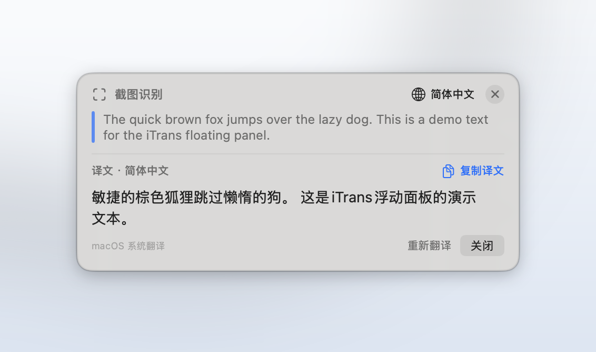
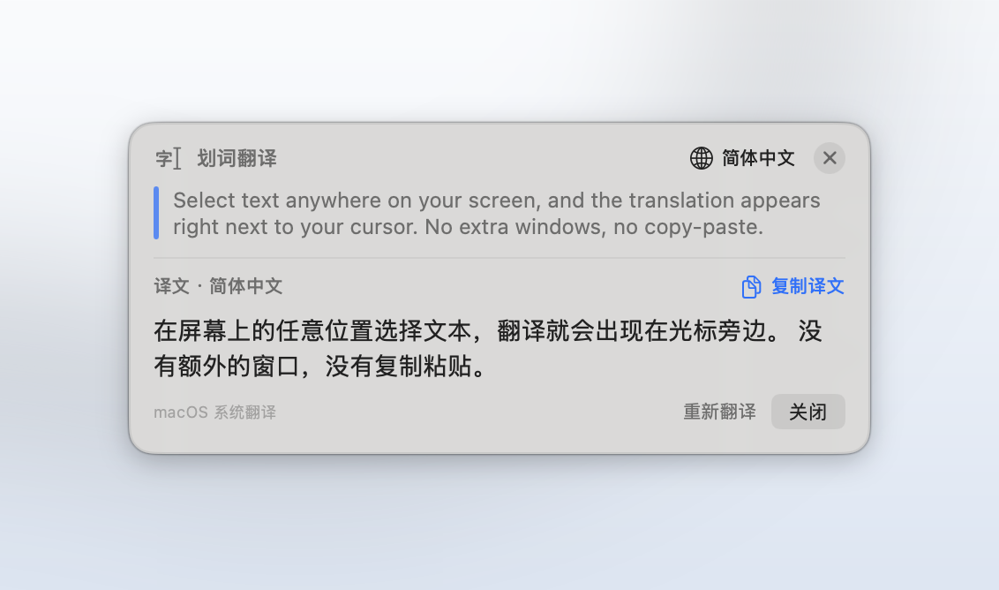
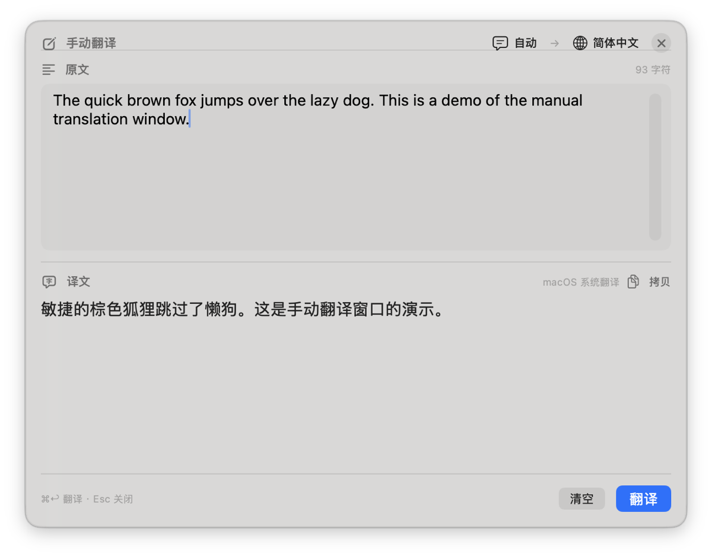
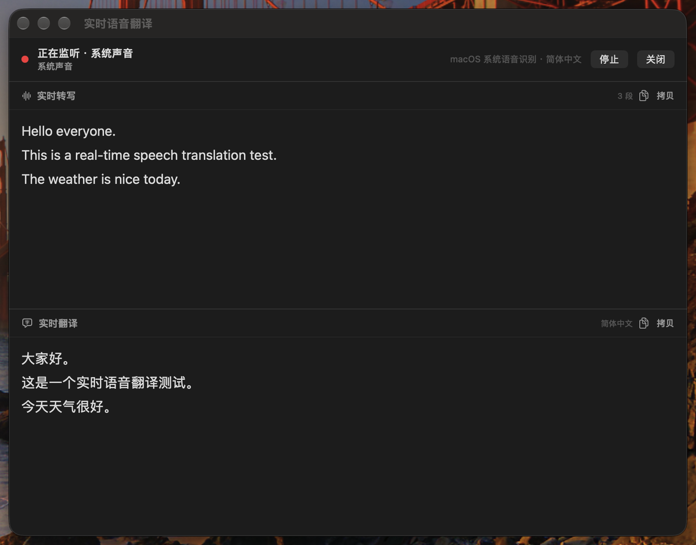
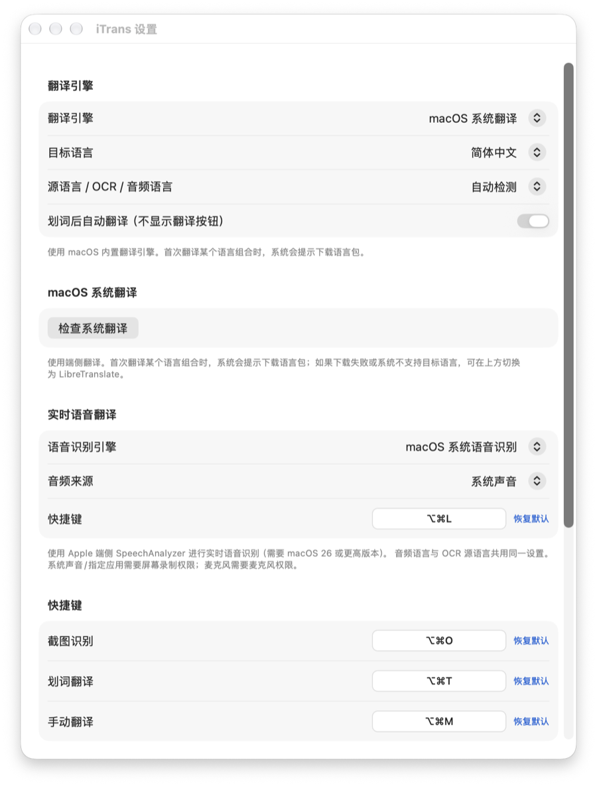

# iTrans

English | [简体中文](README.md)

A native macOS menu bar translation app with **screenshot OCR translation**, **selection translation**, **manual text translation**, and **live speech translation**.

The app lives in the menu bar with no Dock icon and no window during normal use. Global hotkeys trigger each feature, and results appear near the pointer or in a dedicated live speech translation window. You can switch between **macOS system translation** and **LibreTranslate** at any time.

Current version: **1.2.0**. See [CHANGELOG.md](CHANGELOG.md) for the release history.

## Features

- **Screenshot OCR**: press the hotkey, drag a screen region, run on-device Vision OCR, translate automatically, and show the result near the pointer
- **Selection translation**: read the selected text through the Accessibility API (with a simulated ⌘C fallback), translate it, and show the result
- **Manual translation**: open a text translation window with a hotkey, type or paste text, let the source language auto-detect or pick one, and change the target language at any time
- **Live speech translation**: listen to system audio, a specific app, or the microphone, then transcribe and translate in real time in a dedicated split window
- **Two translation engines**: macOS system translation (default) or LibreTranslate
- **One-click copy**: copy the source text and translation from the result panel or from either pane of the live translation window
- **Movable and resizable windows**: the OCR/selection result panel can be dragged; the manual translation and live speech windows can be dragged, resized from any edge or corner, and remember their size next time
- **Automatic API discovery**: read OpenAPI 3 / Swagger 2.0 documents and match the translation endpoint and fields automatically
- **Multi-display / Retina**: select on any display and crop using native screen pixels
- **Menu bar app**: hidden Dock icon via `LSUIElement`; the menu shows the active engine and permission status

## Screenshots

The OCR, selection, and live speech screenshots use demo language content. Actual translations depend on the selected region or audio and the active translation engine.

### Screenshot OCR

[](docs/screenshots/ocr-translation.png)

### Selection Translation

[](docs/screenshots/selection-translation.png)

### Manual Translation

[](docs/screenshots/manual-translation.png)

### Live Speech Translation

[](docs/screenshots/live-speech-translation.png)

### Settings and Translation Engines

[](docs/screenshots/settings.png)

## Screenshot OCR

1. Press `⌥⌘O`.
2. Drag to select a region on screen. Press `Esc` to cancel.
3. iTrans recognizes the text locally with Vision and automatically translates it.
4. The translation appears in a floating panel near the pointer. If translation fails, retry from the panel or open the API settings.

OCR always translates automatically. The target language can be changed from the result panel header, and the current result is retranslated immediately. The OCR language and audio language share the same “Source language / OCR / Audio language” setting.

## Selection Translation

1. Select text in any app.
2. Press `⌥⌘T`.
3. iTrans reads the selection through Accessibility. If the app does not support it, iTrans simulates ⌘C and restores the previous clipboard contents.
4. By default a “Translate” button appears near the pointer. Enable “Auto-translate after selection” to skip the button and show the translation immediately.

The result panel header can change the target language, and the panel can be dragged by its header. Close it with the × button, `Esc`, or a click outside. It supports copying the source or translation and retrying.

## Manual Translation

The default shortcut is `⌥⌘M`. It opens a text translation window where you can type or paste text and press `⌘↩` or click **Translate**.

- **Source language**: the header menu defaults to “Auto detect”; you can also pin a language. It shares the OCR/audio language setting.
- **Target language**: switch it in the header. It stays in sync with the OCR/selection panel, the live speech window, and Settings.
- Changing the source or target language retranslates the current result automatically.
- Copy the translation with one click, or clear the window to start over. Press `Esc` or click the × button to close it.
- The window uses the same rounded floating-panel style as the live speech window, can be dragged and resized, and remembers its size and position.

## Live Speech Translation

The default shortcut is `⌥⌘L`. Press it again or click the × button in the window header to stop and dismiss the session; “Stop” stops listening but keeps the current content. Pressing the shortcut again starts a new session.

The live window uses the same rounded floating-panel style as the OCR/selection result panel. It can be dragged and is split into two halves. Drag any edge or corner to resize it (minimum 520 × 360; a subtle grip marks the bottom-right corner). The window size and position are remembered and restored the next time it opens.

- **Top**: live transcription. Volatile (not yet finalized) text is shown in a secondary color.
- **Bottom**: live translation. Finalized segments are appended as they arrive, with a live preview for the current volatile text.
- Each pane has a **Copy** button in its header:
  - Copy the full transcription.
  - Copy the full translation.
  - The copied text includes what is currently visible. The button briefly changes to “Copied”.
- **Audio language**: the window header provides an audio-language menu. It shares the “Source language / OCR / Audio language” setting. Changing it restarts speech recognition, keeps the current transcript, and updates Settings immediately.
- **Target language**: choose it from the OCR/selection result panel header, the live speech window header, or Settings. All three share the same setting; new translations use the new target, and the current OCR/selection result panel is retranslated automatically.
- All language choices are stored in the shared settings and stay in sync with the Settings window.

Audio sources (default: System audio):

- **System audio**: capture all system audio, excluding iTrans itself.
- **Specific application**: capture audio from a single app such as a meeting app or browser.
- **Microphone**: use the default input device. Useful for in-person meetings and voice input.

Speech recognition uses Apple's on-device `SpeechAnalyzer` / `SpeechTranscriber` on macOS 26+, and does not depend on Siri or Dictation. Choose the audio language from the window menu or follow the system; it shares the OCR/source language setting. Chinese, English, Japanese, Korean, and more are available. One speech engine is currently built in; the design allows adding third-party engines later.

## Translation Engines

Switch engines in Settings. The choice applies to OCR, selection translation, and live speech translation.

### macOS System Translation (default)

- Uses Apple's on-device `Translation` framework. Text stays on the Mac.
- When the source language is “Auto detect”, the system detects it. You can also pin the source language.
- The first translation for a language pair may prompt macOS to download the language pack. Translation continues after the download.
- A “Check System Translation” button in Settings reports the language-pack status.
- If the pack is unavailable or the target language is unsupported, switch to LibreTranslate.

### LibreTranslate

- Default server: `http://192.168.3.3:5000`.
- Reads `/openapi.json`, `/spec`, and similar documents to discover the translation endpoint, field names, and response shape.
- Supports JSON and `application/x-www-form-urlencoded` requests.
- The currently validated server is LibreTranslate 1.9.6 (Flask + Flasgger).
- To self-host it, use the repository's `docker-compose.yaml`; see “Advanced: Deploy LibreTranslate with Docker” below.

## Default Shortcuts

| Action | Shortcut |
| --- | --- |
| Screenshot OCR | `⌥⌘O` |
| Selection translation | `⌥⌘T` |
| Manual translation | `⌥⌘M` |
| Live speech translation | `⌥⌘L` |

Click a shortcut field in Settings to record a new combination. At least one modifier key is required. Settings are stored in `UserDefaults` (`com.linimbus.itrans`).

## Requirements and Build

- macOS 26.0 or later
- Xcode 26+ (Swift 6 toolchain)

```bash
# Build and launch
./scripts/run.sh

# Build only
./scripts/build_app.sh
open build/iTrans.app

# Create release artifacts (DMG / ZIP / SHA256)
./scripts/release.sh
```

The app is generated at `build/iTrans.app` and is ad-hoc signed. You can also open `Package.swift` directly in Xcode.

`release.sh` writes the release artifacts to `dist/`:

- `iTrans-<version>.dmg`: the app plus an `Applications` shortcut; drag to install.
- `iTrans-<version>.zip`: a compressed app bundle for distribution or archiving.
- `SHA256SUMS.txt`: SHA-256 checksums for both artifacts.

Because the app is ad-hoc signed, Gatekeeper may block the first launch. Allow it in System Settings → Privacy & Security, or run `xattr -dr com.apple.quarantine /Applications/iTrans.app`.

For daily use, copy `iTrans.app` to `/Applications` to keep TCC permission records stable. After rebuilding, permissions may need to be granted again.

## First Run and Permissions

1. The “文” speech-bubble icon appears in the menu bar. There is no window during normal use.
2. Open the menu → **Settings…** and choose the translation engine and target language.
   - The system engine prompts for language-pack downloads on first use.
   - For LibreTranslate, confirm the server address.
3. Grant the required permissions:
   - **Screen Recording**: required for screenshot OCR and for capturing system audio / a specific app. macOS prompts on first use. If iTrans does not appear in the list, enable it in “System Settings → Privacy & Security → Screen Recording”, then restart the app.
   - **Accessibility**: required for selection translation. Enable iTrans in “System Settings → Privacy & Security → Accessibility”.
   - **Microphone**: required for microphone-based speech translation. macOS prompts the first time you start microphone listening.
4. Use the shortcuts.

The menu bar menu shows Accessibility and Screen Recording status. The Settings window also reports permission status and provides shortcuts to the relevant panes.

## Settings

### Translation Engine

- Translation engine: macOS System Translation / LibreTranslate
- Target language
- Source language / OCR / Audio language
- Auto-translate after selection (hide the Translate button)

### Live Speech Translation

- Speech recognition engine (currently macOS system speech recognition)
- Audio source: System audio / Specific application / Microphone
- For a specific app: choose a running app and refresh the list
- For microphone: shows the current default input device
- The audio language is set by “Source language / OCR / Audio language” above and stays in sync with the live window menu
- Live speech translation shortcut

### System Permissions

Shows the status of Accessibility, Screen Recording, and Microphone permissions, with actions to request access or open System Settings.

### Advanced Settings (LibreTranslate)

- Endpoint path (leave empty for auto-discovery)
- HTTP method (POST / GET)
- Text field, target-language field, source-language field
- Translation response path (e.g. `data.translation`)
- Value sent for the target language

To self-host LibreTranslate on this Mac or a LAN server, see “Advanced: Deploy LibreTranslate with Docker” below.

### Other

- Shortcut recording (screenshot OCR / selection translation / manual translation / live speech translation)
- Restore default settings
- Version information

## LibreTranslate API Integration

When LibreTranslate is selected, the default backend is a Flask + Flasgger (LibreTranslate) service:

- Docs: `http://192.168.3.3:5000/docs/`
- Spec: `http://192.168.3.3:5000/spec` (Swagger 2.0)
- Translate: `POST /translate`, `application/x-www-form-urlencoded`
  - `q`: text to translate
  - `source`: source language; use `auto` for detection
  - `target`: target language, e.g. `zh-Hans`, `zh-Hant`, `en`
- Response: `{"translatedText": "...", "detectedLanguage": {...}}`

Example:

```bash
curl -X POST http://192.168.3.3:5000/translate \
  -d 'q=Hello world&source=auto&target=zh-Hans'
```

iTrans discovers the endpoint automatically on the first translation. If the spec is unavailable, a built-in LibreTranslate-compatible fallback is used.

## Advanced: Deploy LibreTranslate with Docker

The repository includes `docker-compose.yaml` for running LibreTranslate on the same Mac or on a LAN server as the translation backend for iTrans.

### Quick start

Requirements: Docker Desktop or OrbStack on macOS, or any Docker Engine with Compose v2.

```bash
# Run from the repository root
docker compose up -d

# Follow the logs. The first start downloads language models and may take a few minutes.
docker compose logs -f libretranslate
```

Check that the service is ready:

```bash
curl http://127.0.0.1:5000/health
curl http://127.0.0.1:5000/languages
```

Test a translation:

```bash
curl -X POST http://127.0.0.1:5000/translate \
  -d 'q=Hello world&source=auto&target=zh-Hans'
```

In iTrans, select LibreTranslate and set the server URL to:

- Docker on the same Mac: `http://127.0.0.1:5000`
- Docker on another LAN machine: `http://<host-lan-ip>:5000`

If port 5000 is already in use, change the compose mapping to `"5001:5000"` and use `http://127.0.0.1:5001` in iTrans. macOS AirPlay Receiver may also occupy port 5000; in that case use 5001 as well, or turn off AirPlay Receiver in System Settings.

### Compose configuration notes

- `LT_LOAD_ONLY`: only load the language models you need. The default is `en,zh-Hans,zh-Hant`. Add codes such as `ja,ko,fr` for other target languages.
- `LT_UPDATE_MODELS`: updates models when the container starts. The first start is slower; set it to `false` for faster subsequent starts if you prefer.
- The `libretranslate_models` volume persists downloaded models. `docker compose down` keeps it; `docker compose down -v` deletes it.
- On Apple Silicon, if you see `exec format error`, uncomment `platform: linux/amd64` in the compose file (emulation is slower), or use an arm64 image when available.
- Do not enable `LT_API_KEYS`: iTrans does not send an `api_key`. Keep the service on a trusted LAN or put access control in front of it.
- When accessing from another device, use the host's LAN IP rather than `127.0.0.1`, and make sure the macOS firewall allows Docker's port forwarding. For same-Mac use only, map the port as `"127.0.0.1:5000:5000"`.
- Upgrade: `docker compose pull && docker compose up -d`.

### API endpoints

After the service starts:

- Swagger UI: `http://127.0.0.1:5000/docs/`
- Spec: `http://127.0.0.1:5000/spec`
- Translate: `POST /translate` with form fields `q` / `source` / `target`
- Response: `{"translatedText": "..."}`

iTrans reads `/openapi.json` or `/spec` and discovers the endpoint automatically. If it reports “no translation endpoint found”, first verify that `/health` and `/languages` are reachable, then check the port mapping, firewall, and server URL.

## Development

```bash
# Local mock backend (Swagger spec + /translate)
python3 scripts/mock_server.py 5017

# Show an OCR result panel using the mock backend
ITRANS_SERVER=http://127.0.0.1:5017 ITRANS_DEMO_AUTO=1 \
  ./build/iTrans.app/Contents/MacOS/iTrans --demo

# Show a selection translation result panel
./build/iTrans.app/Contents/MacOS/iTrans --demo-selection

# Show a populated manual translation window
./build/iTrans.app/Contents/MacOS/iTrans --demo-manual

# Show a populated live speech window (no permissions needed)
./build/iTrans.app/Contents/MacOS/iTrans --demo-audio-window

# Show the region-selection overlay (no Screen Recording permission needed)
./build/iTrans.app/Contents/MacOS/iTrans --demo-select

# Open the live speech translation window directly
./build/iTrans.app/Contents/MacOS/iTrans --demo-audio
```

Logs:

```bash
log stream --predicate 'process == "iTrans"' --level debug
```

## Project Layout

```text
Sources/iTrans/
  App/            AppDelegate, app coordinator, logging
  Models/         Shortcuts, translation engines, translation API models
  Services/       OCR, screen capture, selection reading, region selection,
                  global hotkeys, system translation, LibreTranslate,
                  system-audio/microphone capture, live speech recognition and translation
  Settings/       Settings storage and UI
  UI/             Status bar, floating result panel, manual translation window,
                  live speech window, shortcut recorder
Resources/        Info.plist, AppIcon.icns
docs/screenshots/ README screenshots
scripts/          Build scripts, mock backend
docker-compose.yaml  LibreTranslate Docker deployment
```

## Known Limitations

- Screenshot OCR uses Vision. Auto-detection uses Simplified Chinese, Traditional Chinese, and English. The OCR language follows the “Source language / OCR / Audio language” setting.
- Selection translation depends on the target app supporting `AXSelectedText`. When unsupported, iTrans falls back to a simulated ⌘C and therefore needs Accessibility permission.
- macOS system translation requires the corresponding language pack. If the download fails, switch to LibreTranslate.
- Live speech recognition uses the on-device speech models in macOS 26+. If a model is not ready, iTrans prepares it when listening starts; this may require a network download.
- App-specific audio capture uses ScreenCaptureKit's application filter. If an app routes audio through a separate helper process, it may not be captured on its own; use “System audio” instead.
- Microphone mode uses the default input device. Change it in “System Settings → Sound → Input”.
- The OCR/selection result panel displays up to 24 lines of translation. Use “Copy translation” for the full text.
- Only text translation APIs are supported. File upload and streaming (SSE) endpoints are not supported.
- The manual translation window keeps the last input and translation while the app is running; use **Clear** to reset it.
- Launch at login and translation history are not implemented.
- The live speech translation window keeps only the current session; closing the window clears it.
- The app is ad-hoc signed. System permissions may be reset after a rebuild and must be granted again.
